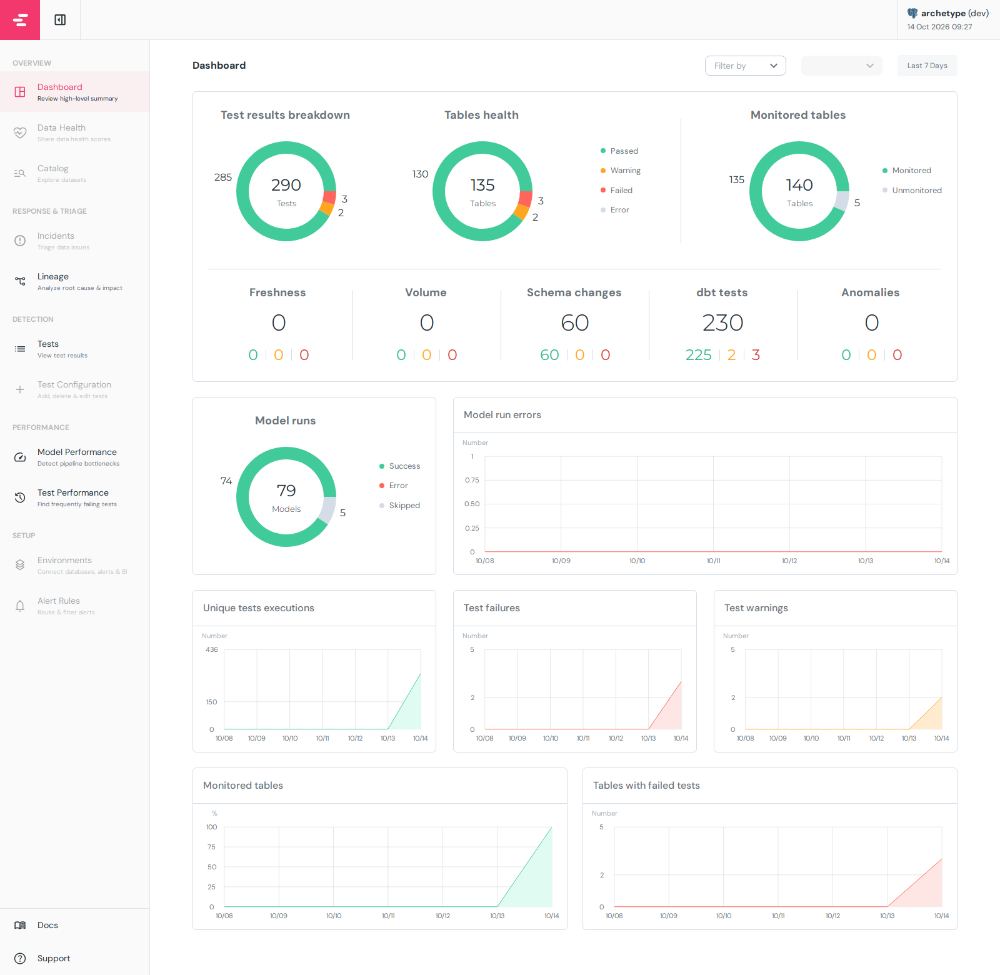
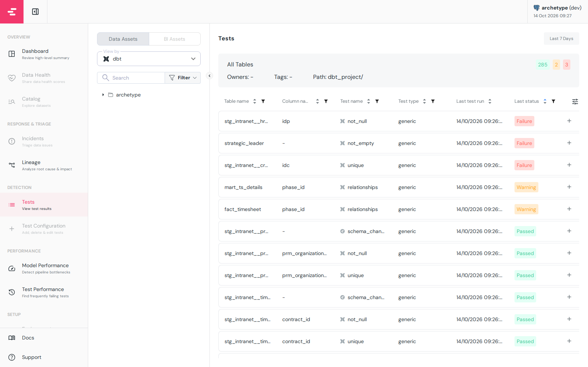
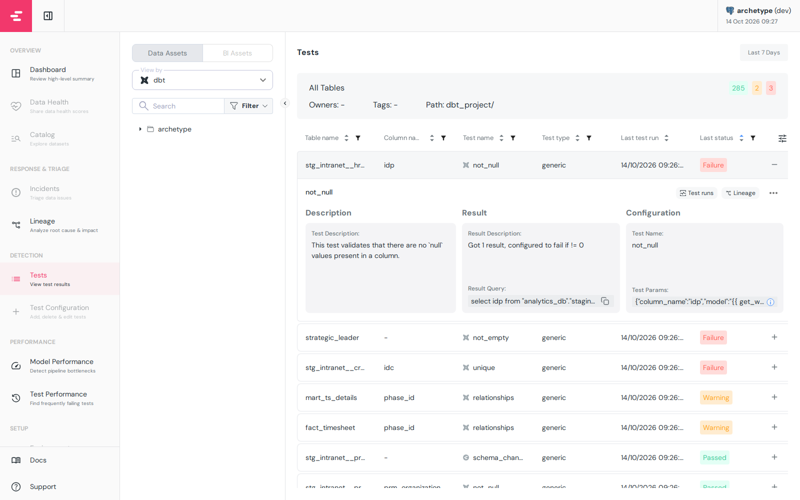
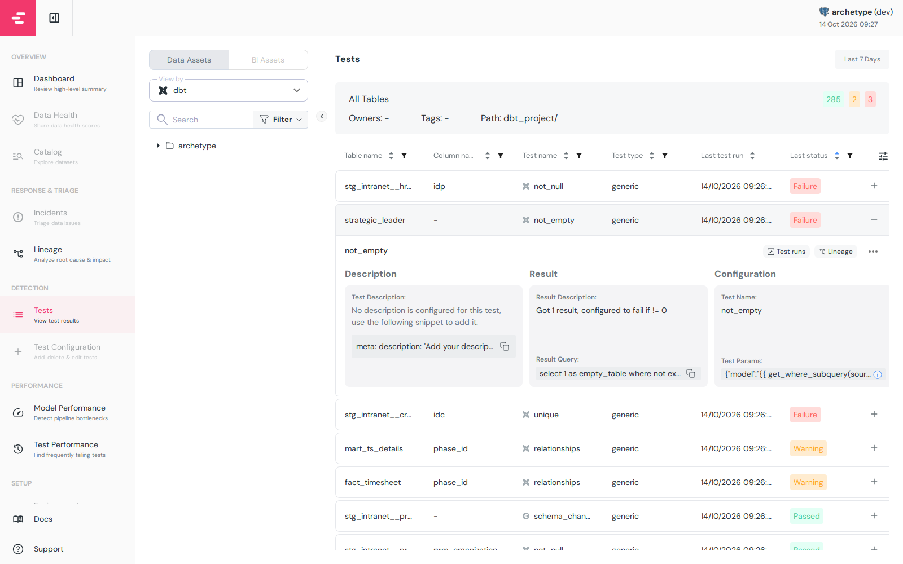
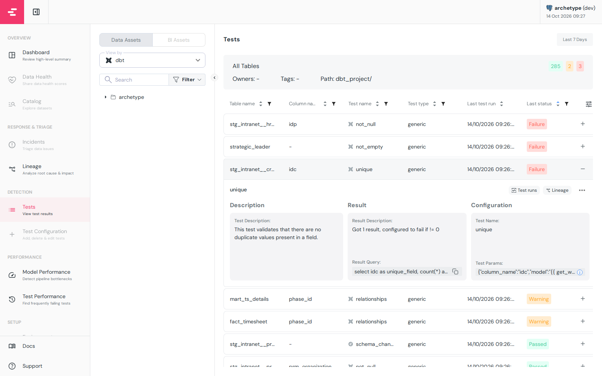
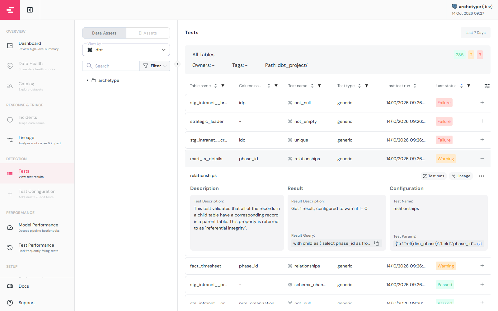
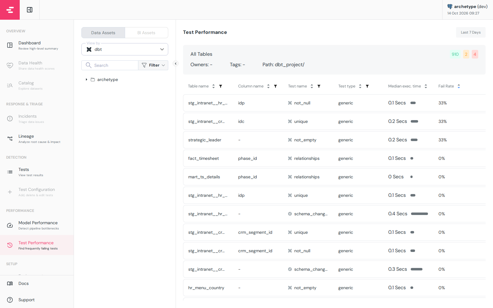
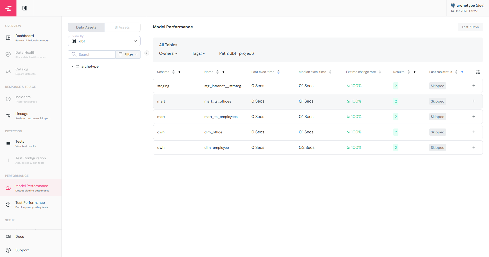
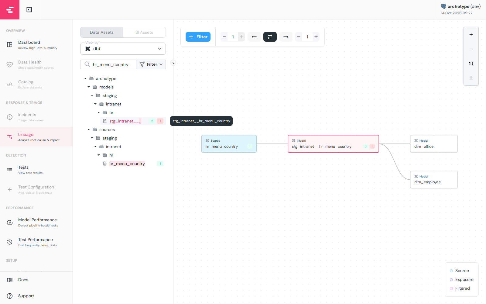

# Đọc báo cáo Elementary

Báo cáo Elementary là **một trang web nằm trong một file**: `report/elementary_report.html`. Nó cho biết lần chạy dbt vừa rồi có test nào hỏng, hỏng ở bảng nào, và hỏng kéo theo những model nào.

- **Tạo ra ở đâu**: bước `[4/4] Elementary report` của `./scripts/run_local.sh` (trên Azure là job image Elementary). Báo cáo được tạo **cả khi có lỗi**.
- **Mở thế nào**: kéo file vào trình duyệt. Không cần server hay cài gì, dữ liệu nằm trong file (khoảng 6 MB).
- **Nó hiển thị gì**: kết quả các lần chạy trong **7 ngày gần nhất**, lấy từ schema `elementary` của database.
- **Mỗi lần chạy ghi đè** file cũ. Muốn giữ làm bằng chứng thì lưu lại (mục 7).

> Ảnh trong tài liệu này chụp từ báo cáo thật, sau một lần chạy **cố ý làm hỏng 4 chỗ**: một cột khóa `NULL` (`hr_menu_country.idp`), một khóa trùng (`crm_main.idc`), một bảng raw rỗng (`strategic_leader`) và một tham chiếu mồ côi (`phase_id = 999`). Trên dữ liệu bình thường mọi thứ hiện màu xanh. Cách tạo từng lỗi xem [ERROR-SCENARIOS](ERROR-SCENARIOS/README.vi.md).

## 1. Menu bên trái

Chỉ **5 trang** dùng được:

| Trang | Dùng để |
|---|---|
| **Dashboard** | xem nhanh tình hình chung |
| **Tests** | xem từng test đạt hay hỏng, và dòng dữ liệu hỏng |
| **Test Performance** | tìm test hay hỏng hoặc chạy chậm |
| **Model Performance** | tìm model chạy chậm hoặc bị bỏ qua |
| **Lineage** | xem lỗi ở bảng này ảnh hưởng tới model nào |

Các mục còn lại (Data Health, Catalog, Incidents, Test Configuration, Environments, Alert Rules) bị làm mờ và bấm không có tác dụng trong báo cáo này; bỏ qua.

## 2. Dashboard: tình hình chung



| Ô | Nghĩa | Trong ảnh |
|---|---|---|
| **Test results breakdown** | tổng số test, chia theo kết quả | 290 test: **285 đạt** (xanh), **2 cảnh báo** (cam), **3 hỏng** (đỏ) |
| **Tables health** | số bảng/model, chia theo kết quả test của nó | 135 bảng: 130 đạt, 2 cảnh báo, 3 hỏng |
| **Monitored tables** | bảng có ít nhất một test (xanh) và bảng không có test nào (xám) | 135 có test, 5 không |
| **dbt tests** | số test do dbt chạy, ba số *đạt / cảnh báo / hỏng* | 225 / 2 / 3 |
| **Schema changes** | riêng test `schema_changes` (đổi cột model staging) | 60 / 0 / 0 |
| **Freshness, Volume, Anomalies** | các loại test theo dõi độ mới, số dòng, bất thường | toàn 0 vì repo chưa dùng loại test này |
| **Model runs** | số model chạy, chia thành xanh (thành công), đỏ (lỗi), xám (bị bỏ qua) | 79 model: 74 thành công, **5 bị bỏ qua** |
| **6 biểu đồ phía dưới** | *Model run errors*, *Unique tests executions*, *Test failures*, *Test warnings*, *Monitored tables* (%), *Tables with failed tests*: mỗi biểu đồ theo từng ngày trong 7 ngày, để xem **xu hướng** | đường chỉ bắt đầu từ ngày có dữ liệu (ở đây chỉ có hôm nay, 10/14) |

**Nhìn vào đâu để biết có lỗi**: các con số **đỏ khác 0** (Failed, dbt tests) và ô xám ở **Model runs**. Số đỏ khác 0 nghĩa là có test hỏng; ô xám nghĩa là có model bị bỏ qua vì thứ nó phụ thuộc đã hỏng.

Lưu ý: các số này **không tính test bị bỏ qua** (SKIP). Trong lần chạy này có 15 test bị bỏ qua nhưng tổng vẫn là 290 = 285 + 2 + 3. Muốn thấy cả test bị bỏ qua, xem mục 7 (xuất CSV).

## 3. Tests: test nào hỏng, hỏng ở đâu



Mỗi dòng là một test: **bảng**, **cột**, **tên test** (`not_null`, `unique`, `not_empty`, `relationships`, `schema_changes`...), **lần chạy cuối** và **trạng thái**. Dòng **Failure** (đỏ) và **Warning** (cam) được xếp lên đầu. Ba số `285 | 2 | 3` ở đầu bảng là đạt, cảnh báo, hỏng.

Muốn biết **chi tiết**, bấm vào dòng (hoặc dấu `+` bên phải). Một khung mở ra gồm ba phần:

| Phần | Cho biết |
|---|---|
| **Description** | test này kiểm tra điều gì |
| **Result**: *Result Description* và ***Result Query*** | kết quả (`Got 1 result, configured to fail if != 0`) và **câu SQL trả về đúng các dòng hỏng** |
| **Configuration** | tên test và tham số (cột nào, model nào) |

Hai nút `Test runs` (lịch sử chạy của test này) và `Lineage` (xem mục 4 và 6) nằm ngay trên khung.

### Result Query: thấy ngay dòng dữ liệu hỏng

Copy câu trong **Result Query** và chạy vào database local là thấy dữ liệu hỏng:
```bash
docker compose exec -T postgres-local psql -U postgres -d analytics_db -c '<dán Result Query vào đây>'
```
Bốn ví dụ từ lần chạy chụp ảnh. Câu truy vấn lấy nguyên từ báo cáo, kết quả là chạy thật:

**Cột khóa `NULL`** (`not_null`)


```sql
select idp from "analytics_db"."staging"."stg_intranet__hr_menu_country" where idp is null
```
```
 idp
-----
(1 row)        -- một dòng có idp rỗng
```

**Bảng raw rỗng** (`not_empty`)


```sql
select 1 as empty_table where not exists (select 1 from "analytics_db"."raw_intranet"."strategic_leader")
```
```
 empty_table
-------------
           1        -- có kết quả nghĩa là bảng rỗng
```
Khung này ghi `No description is configured for this test`: chỉ là chưa có mô tả cho test, không phải lỗi.

**Khóa trùng** (`unique`)


```sql
select idc as unique_field, count(*) as n_records from "analytics_db"."staging"."stg_intranet__crm_main" where idc is not null group by idc having count(*) > 1
```
```
 unique_field | n_records
--------------+-----------
            1 |         2        -- khóa 1 xuất hiện 2 lần
```

**Tham chiếu mồ côi** (`relationships`, chỉ cảnh báo)


Ở đây `Result Description` ghi `configured to **warn** if != 0` thay vì `fail`: test đặt `severity: warn` nên chỉ cảnh báo, không chặn chuỗi. Câu trong *Result Query* trả về giá trị `phase_id` không có trong bảng cha:
```
 from_field
------------
        999
```

## 4. Test Performance: test nào hay hỏng, hay chậm



Mỗi dòng là một test, tính trên **cả 7 ngày**: thời gian chạy trung vị (**Median exec. time**), **Fail Rate** (tỉ lệ lần chạy bị hỏng) và **Results** (số lần đạt rồi số lần hỏng). Ví dụ trong ảnh: `not_null` trên `idp` hỏng 33% số lần chạy. Cảnh báo không tính vào Fail Rate (`relationships` đang cảnh báo mà vẫn ghi 0%).

Dùng để: tìm test **hỏng đi hỏng lại** (có thể do nguồn dữ liệu không ổn định), hoặc test **chạy chậm**. Số `910 | 2 | 4` ở đầu bảng là số lần chạy (đạt, cảnh báo, hỏng), không phải số test.

## 5. Model Performance: model chạy chậm hoặc bị bỏ qua

Mỗi dòng là một model: thời gian chạy lần cuối, thời gian trung vị, mức thay đổi, số lần chạy và **Last run status** (`Success`, `Skipped`, `Error`). Dùng để thấy model nào **chậm bất thường** và model nào **bị bỏ qua**.

Danh sách dài (79 model). Bấm biểu tượng phễu cạnh **Last run status** rồi chọn `Skipped` để chỉ xem các model bị bỏ qua:



Năm model trong ảnh đều **bị bỏ qua vì một test phía trước hỏng**: `strategic_leader` (bảng raw rỗng), `dim_employee` và `dim_office` (phụ thuộc `hr_menu_country` có khóa `NULL`), cùng `mart_ts_employees` và `mart_ts_offices` (phụ thuộc hai dim đó). Model bị bỏ qua **giữ nguyên dữ liệu của lần chạy thành công trước**, nên mart không bị ghi đè bằng dữ liệu hỏng.

## 6. Lineage: lỗi này ảnh hưởng tới đâu



Gõ tên bảng vào ô **Search** ở cột trái rồi bấm vào model: đồ thị hiện **nguồn → model → các model phía sau**. Con số nhỏ trên mỗi hộp là số test (xanh: đạt, đỏ: hỏng). Hộp **viền đỏ** là model có test hỏng.

Trong ảnh: bảng raw `hr_menu_country` → `stg_intranet__hr_menu_country` (2 test đạt, **1 hỏng**) → `dim_office` và `dim_employee`. Nghĩa là lỗi khóa `NULL` ở bảng quốc gia làm hai dim này không chạy được (đúng như mục 5), và từ đó các mart phía sau cũng bị ảnh hưởng.

## 7. Làm bằng chứng

| Muốn có | Cách làm |
|---|---|
| **Ảnh chụp** | chụp trang **Dashboard** (số đỏ) và **Tests** (dòng Failure, kèm khung chi tiết) |
| **Cả báo cáo** | copy file ra chỗ khác **trước lần chạy kế tiếp**: `cp report/elementary_report.html ~/evidence/elementary_report_$(date +%F_%H%M).html`. File mở lại được sau này và thấy đúng dữ liệu của thời điểm đó |
| **Bảng kết quả** (cả test bị bỏ qua) | xuất CSV: lệnh bên dưới |
| **Log chi tiết** | copy `report/logs/3-dbt.log` |

Xuất danh sách test không đạt của lần chạy gần nhất ra CSV:
```bash
docker compose exec -T postgres-local psql -U postgres -d analytics_db -c "\copy (
  select to_char(detected_at,'YYYY-MM-DD HH24:MI:SS') as detected_at, status, test_short_name,
         table_name, column_name, test_results_description
  from elementary.elementary_test_results
  where status <> 'pass' and detected_at > now() - interval '1 hour'
  order by detected_at desc) to stdout with csv header" > test_results.csv
```
Trạng thái trong CSV là `fail`, `warn` hoặc `skipped`. Kết quả của lần chụp ảnh (rút gọn):
```
detected_at,status,test_short_name,table_name,column_name,test_results_description
2026-10-14 09:26:37,warn,relationships,mart_ts_details,phase_id,"Got 1 result, configured to warn if != 0"
2026-10-14 09:26:37,fail,not_null,stg_intranet__hr_menu_country,idp,"Got 1 result, configured to fail if != 0"
2026-10-14 09:26:37,skipped,unique,dim_office,office_id,
2026-10-14 09:26:36,fail,not_empty,strategic_leader,,"Got 1 result, configured to fail if != 0"
2026-10-14 09:26:36,fail,unique,stg_intranet__crm_main,idc,"Got 1 result, configured to fail if != 0"
```
Nhớ lưu bằng chứng **ngoài repo** (ví dụ `~/evidence/`): thư mục `report/` được `.gitignore` và theo quy ước repo không được commit.

## 8. Muốn biết gì thì nhìn đâu

| Câu hỏi | Nhìn ở |
|---|---|
| Lần chạy này có lỗi không? | **Dashboard**: số đỏ khác 0, ô xám ở Model runs |
| Test nào hỏng, ở bảng và cột nào? | **Tests**: các dòng Failure ở đầu bảng |
| Dòng dữ liệu nào hỏng? | **Tests** → mở dòng → **Result Query** → chạy trong `psql` |
| Lỗi này ảnh hưởng báo cáo nào? | **Lineage** (hoặc **Model Performance** lọc `Skipped`) |
| Model nào chạy chậm hoặc bị bỏ qua? | **Model Performance** |
| Test nào hay hỏng? | **Test Performance**: cột Fail Rate |
| Cảnh báo (WARN) là gì, có chặn gì không? | **Tests** → dòng Warning → `configured to warn`; không chặn chuỗi |
| Lỗi SQL của model, `Compilation Error`, lỗi kết nối | **không nằm trong báo cáo**: xem màn hình và `report/logs/3-dbt.log` ([ERROR-SCENARIOS](ERROR-SCENARIOS/README.vi.md)). Khi dbt không chạy được, báo cáo vẫn được tạo nhưng chỉ phản ánh **lần chạy trước** |

## 9. Lưu ý

- Số liệu là của **7 ngày gần nhất**, gom nhiều lần chạy. Một lần chạy riêng lẻ (`--select`) cũng được ghi vào.
- Test bị bỏ qua **không được tính** ở Dashboard (xem mục 2); chỉ thấy trong database hoặc CSV.
- Khi mở, trang tải font từ `fonts.googleapis.com` và `fonts.gstatic.com`. Máy không có mạng vẫn xem được, chỉ khác phông chữ. Lần mở thử không thấy trang gọi thêm địa chỉ nào khác.
- **Dữ liệu cá nhân**: Elementary có cơ chế lưu vài dòng mẫu của test hỏng (bảng `elementary.test_result_rows`, tùy chọn `--disable-samples` của `edr`). Trong lần chụp ảnh bảng này **trống** và báo cáo không chứa dòng dữ liệu nào, chỉ có tên bảng, tên cột và câu SQL. Khi chạy với dữ liệu thật (có chứa dữ liệu cá nhân), nên kiểm tra lại bảng này trước khi gửi báo cáo cho người ngoài.
